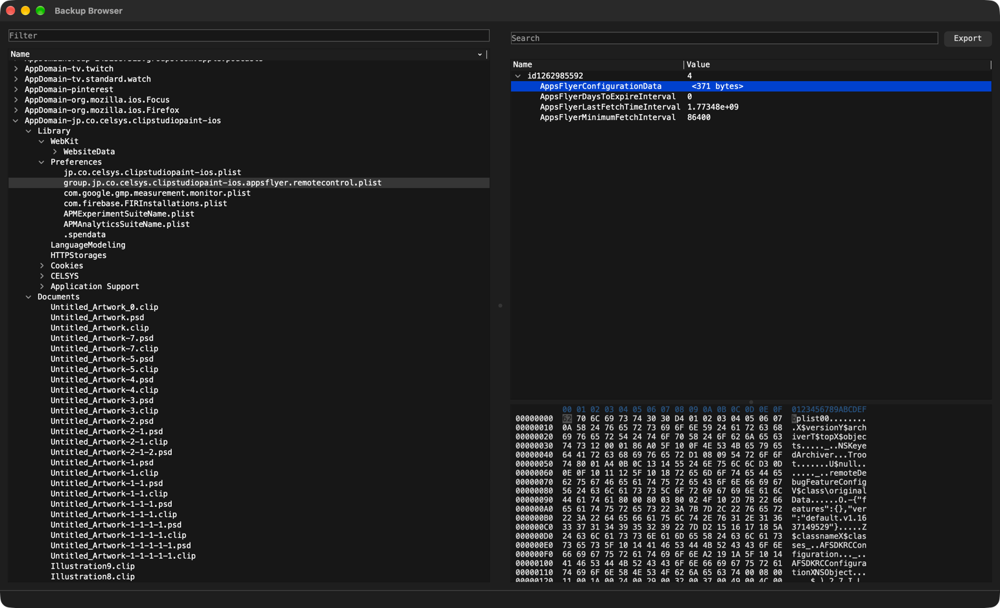

# libiosbackups

cross-platform iOS backup parsing library and app,
written in a weekend as an excuse to learn about the format of iOS backups. 

---

the guts of backup parsing are in src/lib/Backup.cpp if that is why you're here. 

this is not slop. i do really enjoy writing Qt code so do expect this to get turned into a nicer app down the road.

---

11/2/16: ui code is very much not up to my standards right now. currently this allows everything you need to dig
around a backup but it is so very much an MVP at this time.

global todo: 
* I feel like we may want a global SQL helper at some point, we deal w/ a lot of sqlite in this project. 
* better backup selection UX than what currently exists (bad) 